Marisetti Avinash
CH.SC.U4CYS23024
Amrita Vishwa Vidyapeetham Chennai
24CYS401 Secure Software Engineering
8 October 2026

## Purpose and implementation

This submission connects the assigned college lost-and-found problem to all sixteen secure software engineering phases. The application supports lost and found reporting, verified-item search, private contact, reporter-only recovery and administrator moderation. Requirements, models, backlog identifiers, source code and tests use a common catalog.

The delivered system is a locally operated laboratory application. Demonstration reports and messages are test data. A successful technical workflow demonstrates the software, rather than a real campus handover. Generic examination-specific examples in the instruction sheet are adapted to this assigned case study under its General Case-Study Instruction.

## Evidence and sprint interpretation

Two nominal sprint plans each span exactly fifteen days: 8 October to 23 October and 23 October to 7 November 2026, at 09:00 Asia/Kolkata. Work and Jira transitions were performed during a compressed laboratory demonstration. Planned calendar burndown values are labelled forecasts; actual API history and test/deployment logs are retained separately. No fifteen-day execution history is claimed.

| Artifact | Location |
| --- | --- |
| Working source and tests | app.py; schema.sql; templates/; static/; tests/ |
| Secure containers and deployment | Dockerfile; compose.yaml; deploy/kubernetes.yaml; deploy/Caddyfile |
| Jira | https://mavinash.atlassian.net/jira/software/c/projects/CLF24/boards/236 |
| Models and wireframe evidence | deliverables/images/; deliverables/editable/ |
| Machine readable traceability | deliverables/catalog.json; tables/*.csv; security-analysis.json |
| Raw verification records | deliverables/evidence/ |
| Editable report | deliverables/College_Lost_and_Found_Report.md |

## Submission contents

01  Agile process

02  Requirements engineering

03  Use cases and analysis

04  Data and information flow

05  Architecture and design

06  User interface

07  Threat and vulnerability analysis

08  Attack tree and refinement

09  Product backlog and Jira

10  Sprint execution and metrics

11  Secure build

12  Secure coding and refactoring

13  Docker and Kubernetes

14  CI and security testing

15  Monitoring and deployment hardening

16  Final security review

# Phase 1 Agile Process and Development Approach

Scrum with XP practices suits the project because user-facing reporting can be delivered in short increments while privacy and authorization are checked continuously. Marisetti Avinash performs the development work and is the only Jira assignee. Product Owner and Scrum Master responsibilities are described as role responsibilities for this individual lab; no fictitious team members or meetings are claimed.

| Practice | Project application |
| --- | --- |
| Two fifteen-day sprints | Sprint 1 delivers campus workflows. Sprint 2 strengthens security and deployment. |
| Definition of Ready | Requirement ID, actor, acceptance criteria, privacy impact and estimate exist. |
| Definition of Done | Feature implemented; related tests pass; security checks reviewed; evidence retained; documentation and Jira synchronized. |
| XP testing and refactoring | Test owner permissions and private messaging before release; centralize validation and route guards. |
| Small increments | Identity → reports → moderation → private contact → recovery → hardening and packaging. |

| Agile principle | Concrete mapping |
| --- | --- |
| Early continuous delivery | A working reporting flow is checked before deployment packaging. |
| Welcome changing requirements | Acceptance criteria and catalog change together when privacy or moderation rules change. |
| Working software is the measure | Browser workflow and container health support completion claims. |
| Technical excellence | Parameterized SQL, scrypt hashing, role checks and automated tests are part of implementation. |
| Simplicity | Use a modular monolith and SQLite for a single-node lab rather than unnecessary distributed services. |
| Regular reflection | Retrospective actions address dependency checking and moderation coverage. |

## Refactoring opportunities

Opportunity 1 replaces a raw item update with reporter authorization, state validation and parameterized SQL. Opportunity 2 replaces role and password trust in an initial teaching example with an allowlisted registration role and scrypt hashing. Phase 12 contains the before/after source evidence; the insecure example is stored as text and is never served.

| Risk | Mitigation |
| --- | --- |
| Security work loses priority to visible features | Make authorization, input validation and privacy tests acceptance criteria; include a security review in Done. |
| Rapid iterations create inconsistent models and backlog | Use catalog.json as the identifier authority; regenerate tables and verify a critical trace across all phases. |

# Phase 2 Requirements Engineering

| Stakeholder | Goal and permitted authority |
| --- | --- |
| Student | Report lost/found items; search verified reports; private contact; recover own report. |
| Faculty | Same reporting features, with faculty role recorded; no moderation privilege. |
| Administrator | Verify/remove suspicious reports and inspect audit metadata; no blanket private-inbox access. |
| Operator | Provision administrator, manage secrets, containers, storage, TLS and backups; privileged operational actor. |

| ID | Requirement | Acceptance condition | Priority | Trace |
| --- | --- | --- | --- | --- |
| R01 | Account registration and sign in | Student and faculty register; administrator is provisioned by operator. | Must | UC01 / US01 |
| R02 | Report a lost item | Capture title description category location and date; create pending report. | Must | UC02 / US02 |
| R03 | Report a found item | Use the same validated workflow with kind found. | Must | UC02 / US03 |
| R04 | Search verified reports | Search title description location and filter kind/category. | Must | UC03 / US04 |
| R05 | Private owner or finder contact | Authenticated contact through recipient-scoped internal inbox. | Must | UC04 / US05 |
| R06 | Owner-only recovery | Only the reporting user can close an open verified report. | Must | UC05 / US06 |
| R07 | Administrator moderation | Administrator verifies or soft-removes suspicious reports with reason. | Must | UC06 / US07 |
| R08 | Personal report tracking | Owner can see their pending verified and removed reports. | Should | UC07 / US08 |
| R09 | Secure communication and sessions | TLS cookie security CSRF request limits CSP and password hashing. | Must | UC01 / US09 |
| R10 | Malicious content prevention | Escape displayed text and use parameterized SQL and bounded input. | Must | UC02 / US10 |
| R11 | Security audit and monitoring | Record login denial moderation recovery and message metadata without body or password. | Must | UC08 / US11 |
| R12 | Private reply and abuse control | Recipient-only replies; cap messages at ten per minute per sender. | Should | UC04 / US12 |
| R13 | Secure Docker packaging | Pinned dependencies non-root read-only rootfs least privilege TLS health check. | Must | UC09 / US13 |
| R14 | Kubernetes deployment | Restricted namespace limits secret PVC ClusterIP network policy. | Must | UC09 / US14 |
| R15 | Verified delivery pipeline | Checkout build tests static check dependency audit image package; fail on errors. | Must | UC09 / US15 |
| R16 | Accessible consistent interface | Responsive labelled controls error feedback cancel clear and progress views. | Should | UC03 / US16 |

| ID | Nonfunctional or security requirement | Verification or limitation |
| --- | --- | --- |
| N01 | Private messages accessible only to participants | Private-inbox and reply-ID tests; administrators do not inherit message access. |
| N02 | All state changes require authenticated authority and CSRF | Role/ownership tests and CSRF rejection test. |
| N03 | Passwords stored as salted scrypt hashes | Database assertion confirms hash form and absence of plaintext. |
| N04 | Bound report/message fields and body size | Title 3–100; description 10–1000; message 5–1000; body ≤16384 bytes; fuzz tests. |
| N05 | TLS for credentials and private contact in deployment | Caddy lab TLS; internal development CA requires trusted client; production requires valid campus certificate. |
| N06 | Thirty-minute session validity configuration | Flask permanent session policy; activity can refresh validity. No immediate central revocation yet. |
| N07 | Responsive accessible interface | Labels, visible errors, keyboard focus, small-screen layout and browser inspection. |
| N08 | Target p95 response below two seconds for a 100-item search | Performance target; a small smoke measurement does not establish concurrent campus-scale capacity. |
| N09 | Auditable privileged changes without secrets in logs | Actor, event, object, outcome and UTC timestamp; password/message contents excluded. |
| N10 | Recoverable private storage | SQLite volume/PVC; backup and retention are operational deployment controls. |

CIA priorities: confidentiality dominates credentials, emails, private messages and secrets; integrity dominates report ownership, moderation and recovery; availability supports search, sign-in and recovery. Authentication identifies the current database user. Authorization separately enforces administrator or reporter/participant policy. Audit records sensitive operation outcomes.

# Phase 3 Requirements Analysis and UML

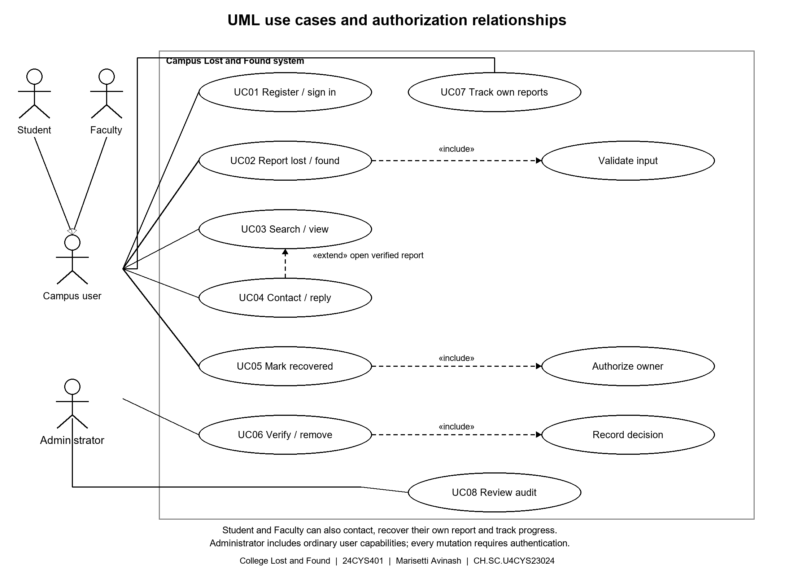

| Use case | Actor | Requirement |
| --- | --- | --- |
| UC01 Register and sign in | Student / Faculty / Administrator | R01 R09 |
| UC02 Report lost or found | Campus user | R02 R03 R10 |
| UC03 Search and view verified items | Campus user | R04 R16 |
| UC04 Contact and reply privately | Campus user / message recipient | R05 R12 |
| UC05 Mark recovered | Report creator | R06 |
| UC06 Verify or remove | Administrator | R07 |
| UC07 Track own reports | Report creator | R08 |
| UC08 Review audit | Administrator | R11 |
| UC09 Deploy verified application | Operator / developer | R13 R14 R15 |

## Critical use case UC02 Report lost or found

| Specification field | Flow |
| --- | --- |
| Primary actor | Authenticated student or faculty. |
| Preconditions | Active session; valid CSRF token; required fields supplied. |
| Main flow | 1 Open report form. 2 Select lost/found and category. 3 Enter title description location and date. 4 Server validates bounds/date and derives reporter ID from session. 5 Save pending report. 6 Record report_created event. 7 Display reference and pending status. |
| Alternative flow | Invalid input returns specific form feedback; user corrects it. Administrator later verifies the report before public search can show it. |
| Exception flow | Expired/forged CSRF returns 400; excessive body returns 413; anonymous actor is redirected to sign-in; database error returns generic 500 response. |
| Postconditions | Report belongs to the authenticated creator; moderation=pending; status=open. No password or account email appears in the report. |
| Security rule | Do not accept reporter_id or administrator authority from the form. |

## Critical use case UC05 Mark item recovered

| Specification field | Flow |
| --- | --- |
| Primary actor | The user who created the report. |
| Preconditions | Authenticated user; valid CSRF; report exists; moderation=verified and status=open; handover has been confirmed by the reporter. |
| Main flow | 1 Open own report. 2 Confirm item recovered. 3 Load report and check reporter_id. 4 Check open verified state. 5 Parameterized update records recovered_at. 6 Append item_recovered audit event. 7 Display recovered state. |
| Alternative flow | A verified found report may be closed by its finder after return. A second recovery request returns 409 and preserves the existing state. |
| Exception flow | Another user receives 403; hidden pending report receives 404; invalid CSRF returns 400; no state change is made. |
| Postconditions | Only the creator changes status to recovered; further contact/reply is rejected; audit metadata records the change. |
| Security rule | Administrator moderation does not grant ownership of another user’s recovery action. |

## Scenario based analysis model

The scenario is Report an Item and Complete Recovery, the domain equivalent of the generic Attend Examination and Submit Answers example. Boundary objects are the report form, details screen and moderation page. Control objects enforce identity, input validation, report state and authorization. Entity objects are User, Report and AuditEvent. The sequence preserves the order of submission, verification and reporter confirmation.

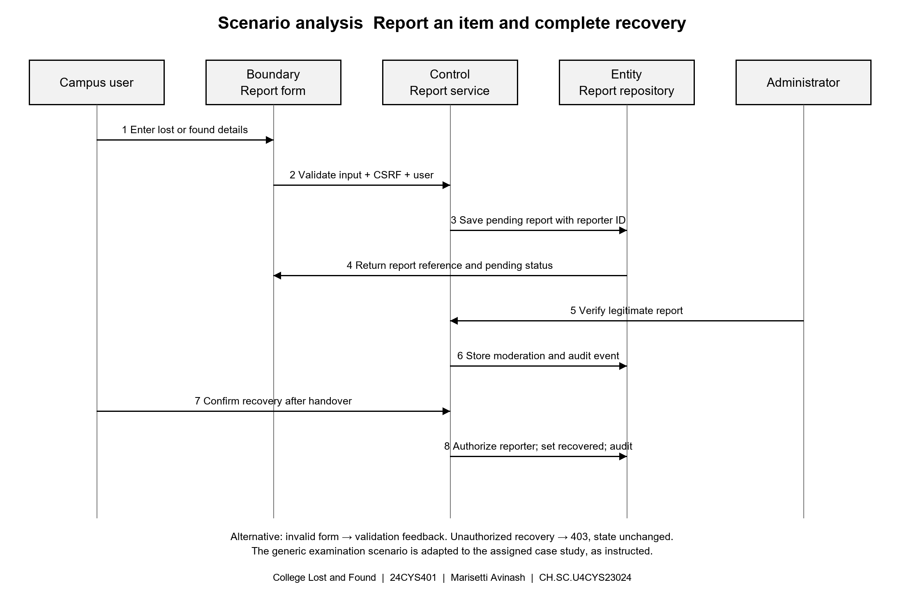

# Phase 4 Data and Information Flow Modeling

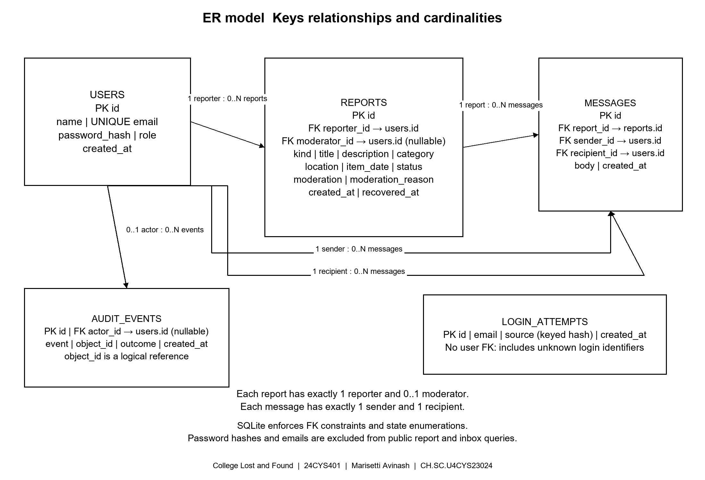

| Relationship | Cardinality and invariant |
| --- | --- |
| User creates Report | One report has exactly one reporter; a user has zero or many reports. |
| User moderates Report | Report has zero or one moderator; administrator may moderate many reports. |
| Report has Message | Message references one report; report has zero or many messages. |
| User sends or receives Message | One sender and one recipient per message; each user may have many sent/received messages. |
| User performs AuditEvent | Zero or one actor per event, allowing unauthenticated denial events; many events per user. |
| LoginAttempt | Independent attempt record includes unknown emails and hashed connection source; no required User FK. |

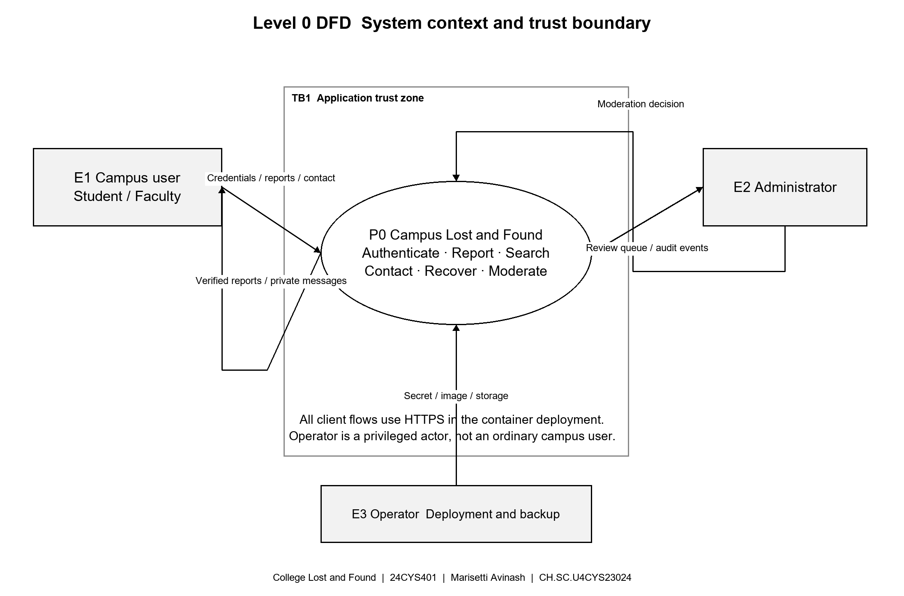

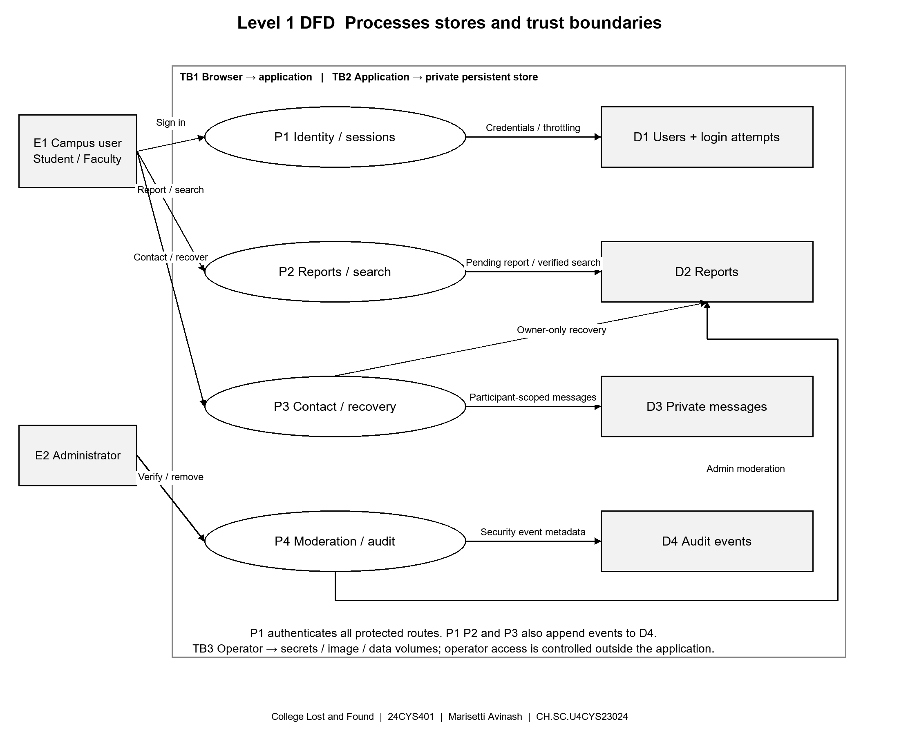

| Element | Responsibility and sensitive flows |
| --- | --- |
| E1 E2 E3 | Campus users, administrators and privileged operator. |
| P1 Identity and sessions | Credentials to D1; salted hash verification, session identity, login throttling. |
| P2 Reports and search | Creates pending D2 records; returns verified public fields or owner-scoped records. |
| P3 Contact and recovery | Writes participant-scoped D3 messages; authorizes reporter recovery in D2. |
| P4 Moderation and audit | Administrator updates D2 verification/removal; records D4 events. |
| D1 D2 D3 D4 | Users/login attempts; reports; private messages; audit events in the same SQLite database. |
| TB1 TB2 TB3 | Browser/application boundary; application/private storage boundary; privileged operator/deployment boundary. |

Consistency check: UC02 maps to P2 and Report, UC04 to P3 and Message, UC05 to P3/D2 and Report, UC06 to P4/D2 and moderator_id, UC08 to P4/D4 and AuditEvent. No separate examination, marks or question-paper entity is introduced into this assigned domain.

# Phase 5 Software Architecture and Design Engineering

A layered modular monolith is appropriate for a small college service and a bounded lab deployment. Server-rendered forms avoid client-side secret storage. A single relational database enforces ownership references and supports a simple recoverable volume. The lab uses one Kubernetes replica with Recreate because SQLite is not a shared multi-replica database.

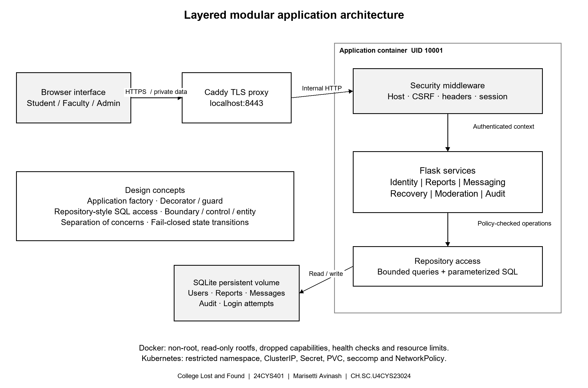

| Component | Interface | Responsibility |
| --- | --- | --- |
| Browser templates and stylesheet | HTML GET and CSRF-protected form POST | Login reporting search details inbox moderation and recovery feedback. |
| Identity and route guards | register login logout; auth decorator | Hash passwords; authenticate; load current database role; deny unauthorized routes. |
| Report service | report items detail recover | Validate input, enforce moderation visibility and reporter-only recovery. |
| Messaging service | contact inbox reply | Derive recipients server-side, enforce participants and bound send rate. |
| Moderation and audit | admin moderate audit() | Record reason/moderator and auditable outcomes; pending-first paginated review. |
| Data access | SQLite parameterized statements | Foreign keys, state checks, WAL persistence and transactions. |
| Deployment edge | Caddy → Gunicorn; ClusterIP service | TLS, process isolation, health checks and resource restrictions. |

| Concept or pattern | Implemented application |
| --- | --- |
| Separation of concerns | Templates render UI; guards enforce access; SQL schema defines state. |
| Application factory | create_app(config) supports isolated test database and deployment configuration. |
| Decorator / guard | auth(admin=True) and CSRF middleware centralize entry checks. |
| Boundary control entity | Forms → services → User/Report/Message/Audit entities. |
| Least privilege and fail closed | Only allowlisted actions/roles; hidden reports return 404; unrelated messages cannot be loaded. |
| Repository-style access | Database connection lifecycle and bound SQL stay server-side; no user-built query execution. |

Domain mapping for the generic architecture instruction: authentication → P1; examination/submission → P2 campus report submission; evaluation/results → P4 verification and P3 recovery status; audit/logging → D4. The components implement the lost-and-found equivalents throughout.

# Phase 6 User Interface Design

| Screen | User goal and navigation | Inputs feedback and security |
| --- | --- | --- |
| Login and registration | All users; proceed to browse after sign-in. | Email/password; generic login failure; 12-character minimum registration; admin role cannot be selected. |
| Browse and search | Students/faculty discover verified items; navigate to report or detail. | Search/type/category filters; result count and empty state; emails absent. |
| Report form | Student/faculty report lost/found; cancel returns to browse. | Bound fields and date; field error feedback; pending state prevents immediate publication. |
| Private inbox and contact | Participants communicate without exposing account emails. | Bound message; reply recipient derived from received message; closed reports hide reply controls. |
| Administrator moderation | Admin verifies/removes suspicious reports; reviews audit. | Reason required for removal; pending-first paginated queue; role guard. |
| Recovery result | Reporter confirms return and sees recovered state. | Explicit confirmation action; server checks owner/open/verified; duplicate action rejected. |

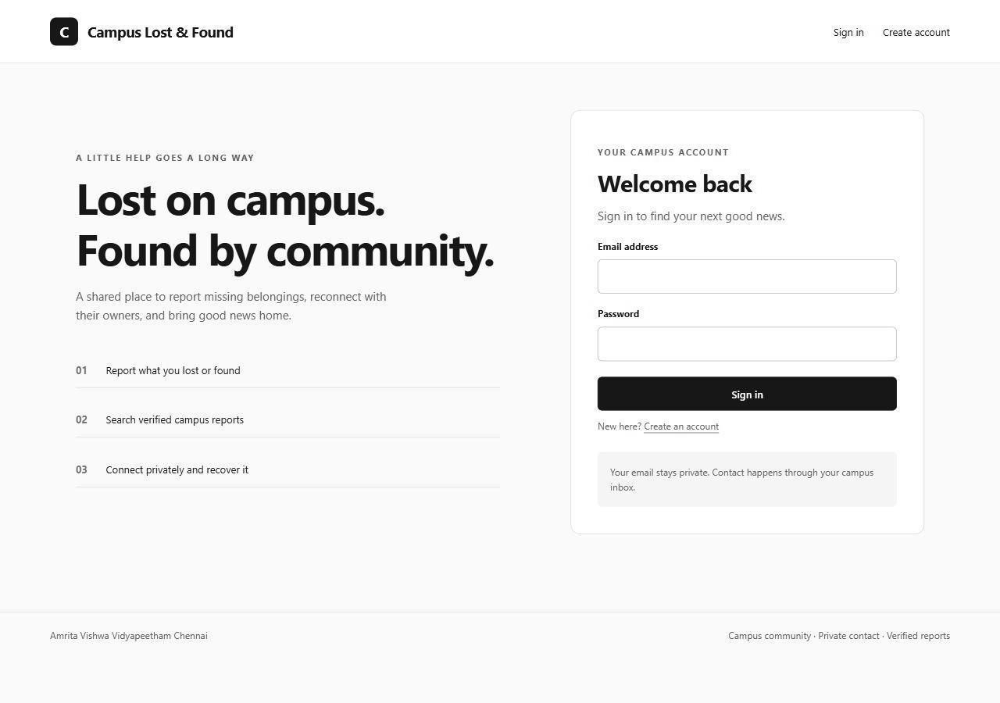

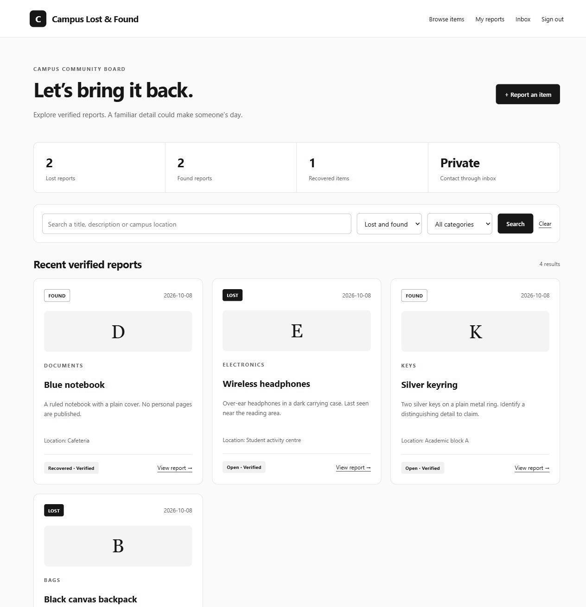

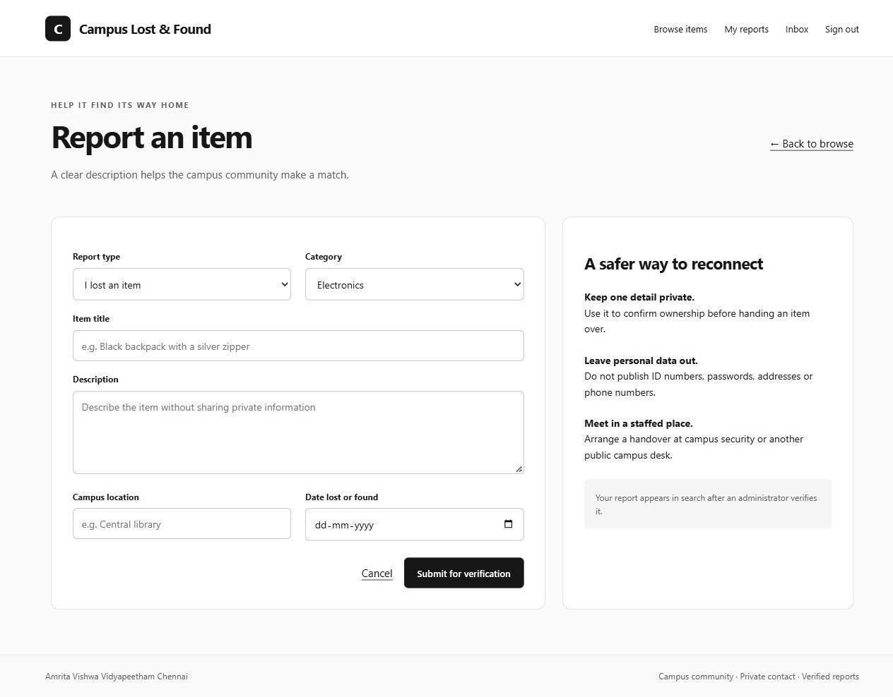

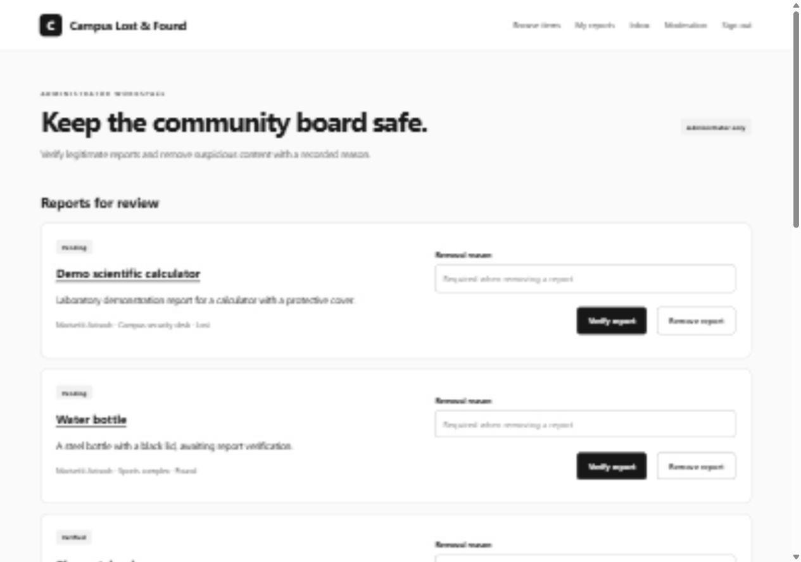

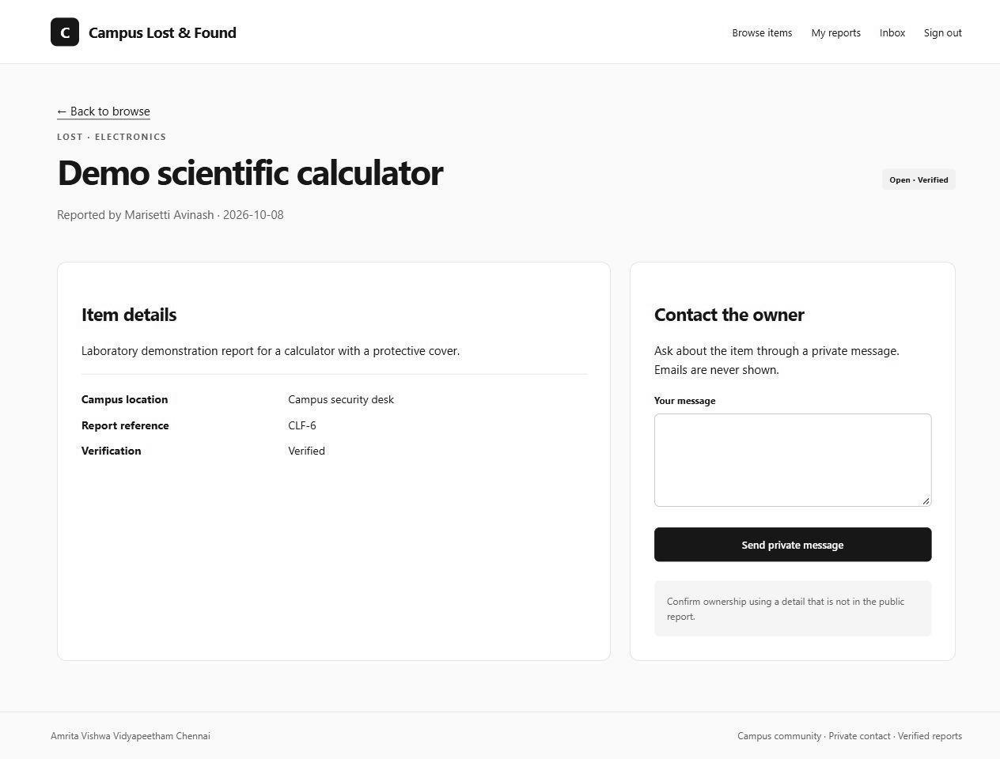

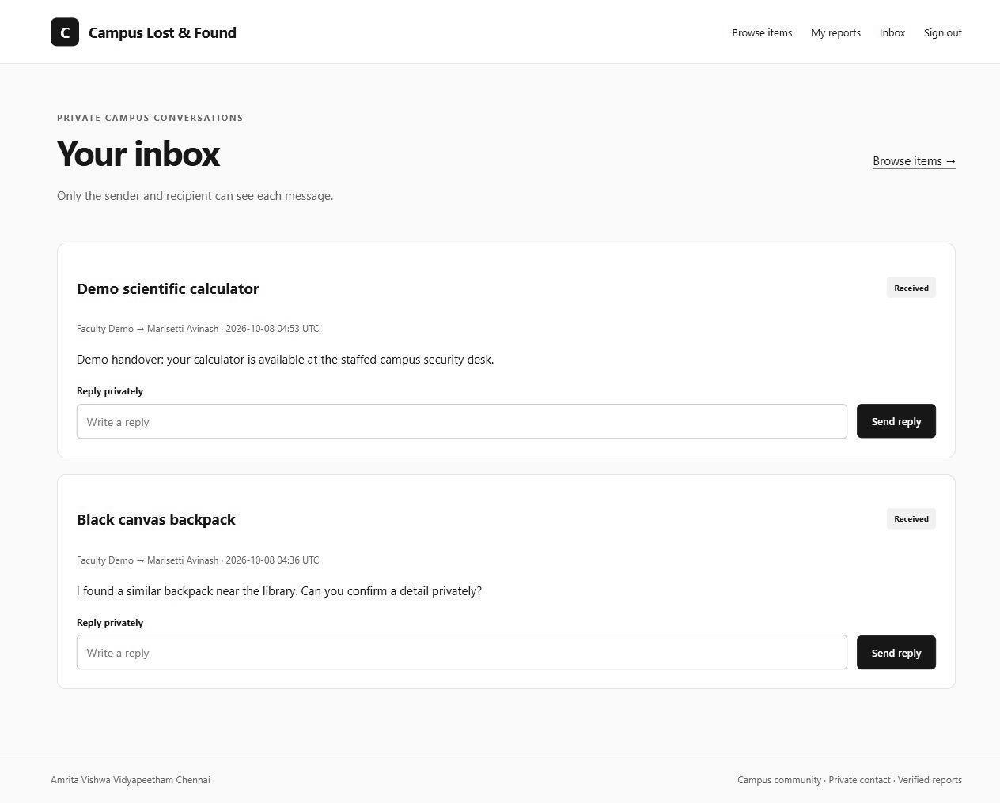

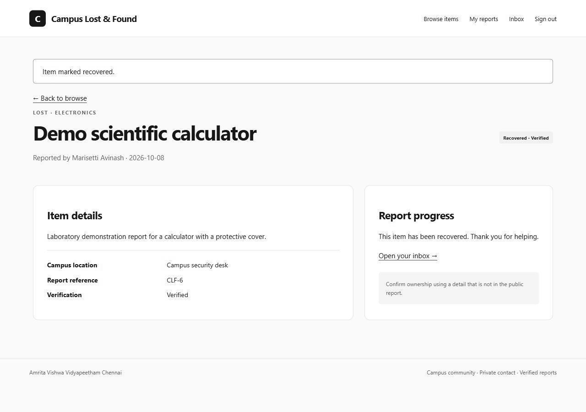

Golden Rules: identical header/navigation and typography provide consistency; Cancel and Clear provide user control; pending/verified/recovered states and notices provide feedback; allowlists and server validation prevent invalid actions; labelled controls and focus outlines support navigation; badges and report references keep state visible. Errors do not expose stack traces. Handovers are encouraged at a staffed campus location.

# Phase 7 Threat Modeling and Security Analysis

| ID | Asset | C | I | A |
| --- | --- | --- | --- | --- |
| A1 | Passwords and credential verification | High | High | Medium |
| A2 | Account email and identity | High | High | Medium |
| A3 | Private message contents | High | High | Medium |
| A4 | Report ownership and recovery state | Medium | High | High |
| A5 | Moderation decisions and reasons | Medium | High | High |
| A6 | Audit metadata | Medium | High | High |
| A7 | Session signing secret and CSRF identity | High | High | High |
| A8 | SQLite volume and backups | High | High | High |
| A9 | Build image and dependency integrity | Medium | High | High |

| ID | DFD | STRIDE | Threat | Impact | Control |
| --- | --- | --- | --- | --- | --- |
| TH01 | P1 / TB1 | S | Credential guessing or forged session | Account impersonation | scrypt; random signing secret; TLS; atomic source/account throttling. |
| TH02 | P2 / D2 | T | Craft SQL syntax in search or report | Read or change unintended records | Fixed SQL with bound parameters; LIKE metacharacters escaped. |
| TH03 | P3 / D2 | T | Recover another user’s report | False recovery and loss of trust | Reporter_id policy; CSRF; verified/open precondition; audit denials. |
| TH04 | P4 / D2 | E | Ordinary user invokes moderation | Unauthorized verification/removal | Current database role check; registration role allowlist; operator-only admin creation. |
| TH05 | P3 / D3 | I | Read or reply to unrelated private message | Private-content disclosure | Participant-scoped SQL; reply recipient authorization; no blanket admin inbox. |
| TH06 | P2 / TB1 | T | Store active malicious markup | Script execution / session abuse | Jinja escaping; no safe rendering; CSP script-src none; text bounds. |
| TH07 | POST routes / TB1 | S | Cross-site request forgery | Unwanted recovery/moderation/message | Session-bound token; token rotation on login; SameSite cookie. |
| TH08 | P1 / P3 | D | Login guessing or message flooding | Resource exhaustion or harassment | Five account/source attempts per 15 minutes; ten sends per minute; body and resource limits. |
| TH09 | D4 | R | Deny having changed report state | Incident attribution failure | Actor object event outcome UTC timestamp; external immutable export is future work. |
| TH10 | TB2 / A8 | I | Read private volume or backup | Message/hash disclosure | Non-root application; operator storage ACL; encryption/backup policies remain operational. |
| TH11 | TB3 / A9 | T | Use vulnerable dependency or altered image | Runtime compromise | Pinned patched versions; dependency audit; build evidence; digest recording and CI gates. |
| TH12 | P1 / E1 | S | Register using an unverified campus identity | Spam and identity misrepresentation | Admin verification of reports; residual risk until campus SSO/email verification. |

Threat scenarios are plausible attack paths, not claims that the finished application is exploitable. STRIDE letters denote Spoofing, Tampering, Repudiation, Information disclosure, Denial of service and Elevation of privilege. Source review and automated tests establish the listed implemented controls; operational controls must be configured by the operator.

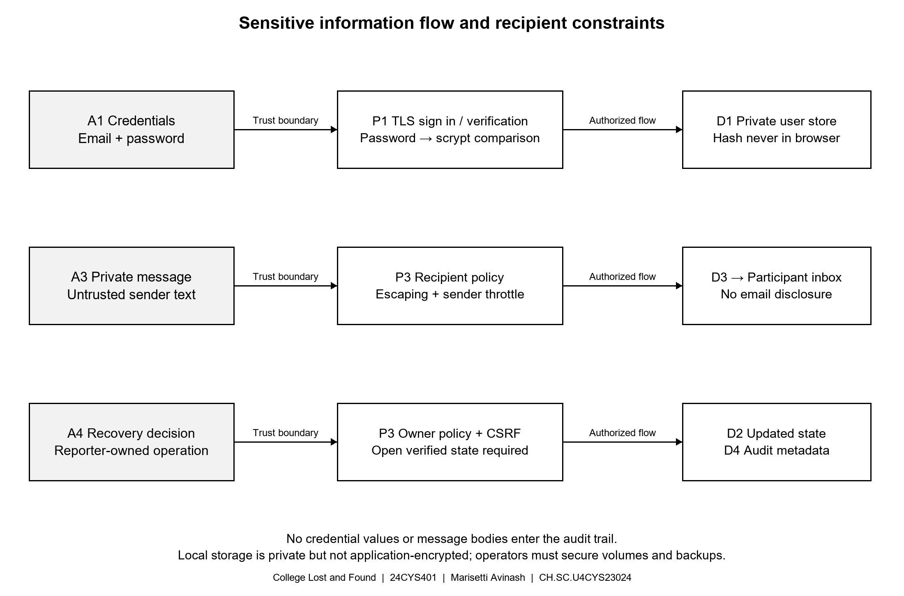

| Asset | Source route and sink | Authorized recipients | Protection and residual issue |
| --- | --- | --- | --- |
| A1 credentials | Browser → TLS → P1 → D1 hash comparison | Identity service; operator-controlled private storage | Plain password is used only for hashing/comparison; secure cookie. No campus SSO yet. |
| A3 private message | Sender → P3 → D3 → participant inbox | Sender and recipient; operator has storage authority | Server-derived recipient, escaped output, no body in audit. DB at-rest encryption is operational. |
| A4 recovery state | Reporter POST → P3 → D2 update → D4 audit | Authenticated reporter writes; verified-report readers see status | Owner policy, CSRF, state check, audit. Creator confirmation does not prove a real-world handover. |

| ID | Affected element | Weakness | Risk | Evidence and status |
| --- | --- | --- | --- | --- |
| V01 | Initial teaching recovery function / TH03 | Missing owner policy and interpolated SQL | High if deployed | Nonexecuted initial example; current implementation fixed and unauthorized-recovery/SQL tests pass. |
| V02 | Initial teaching registration / TH04 | Trust form role and store plaintext password | High if deployed | Nonexecuted initial example; current allowlist and scrypt tests pass. |
| V03 | Invalid host error path / TH08 | Template URL generation without valid routing adapter | Medium availability | Observed in test; safe plain response for unroutable requests; host-validation retest passes. |
| V04 | P1 login throttling / TH08 | Account-wide targeted lockout and nonatomic attempt count | Medium availability | Source review; atomic transaction and hashed connection/account scope added; different-source login retest passes. |
| V05 | Application dependencies / TH11 | Known advisories in initial Flask Werkzeug Click pins | High supply-chain risk | Dependency audit observed 10 advisory records in 3 packages (duplicates included); upgraded; current audit clean. |
| V06 | P4 moderation UI / TH08 | Only newest 100 reports accessible | Medium operational | Source review; pending-first pagination added; older-page test passes. |
| V07 | P3 inbox UI | Reply form shown after report is closed | Low correctness | Source review; closed-report reply control hidden; endpoint still denies; retest passes. |
| V08 | A8 storage / TH10 | No application-layer message encryption at rest | Residual confidentiality | Requires privileged storage access; secure volume/backups and plan managed encryption. Not a demonstrated remote exploit. |
| V09 | P1 campus identity / TH12 | No email verification or campus membership proof | Residual abuse risk | Admin moderation reduces publication risk; campus SSO is a future production requirement. |

# Phase 8 Attack Tree and Security Architecture Refinement

The critical attacker goal is modifying another campus user’s recovery state. It directly threatens report integrity and corresponds to the generic example of changing another student’s result. OR branches cover identity compromise, authorization bypass and privileged storage manipulation. Each branch requires its stated AND prerequisites.

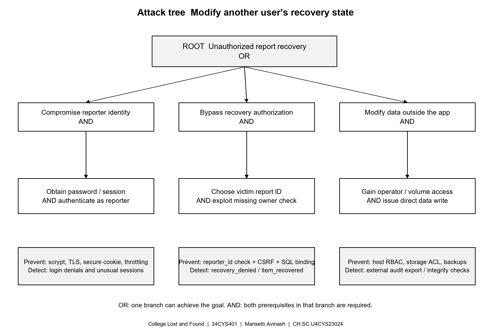

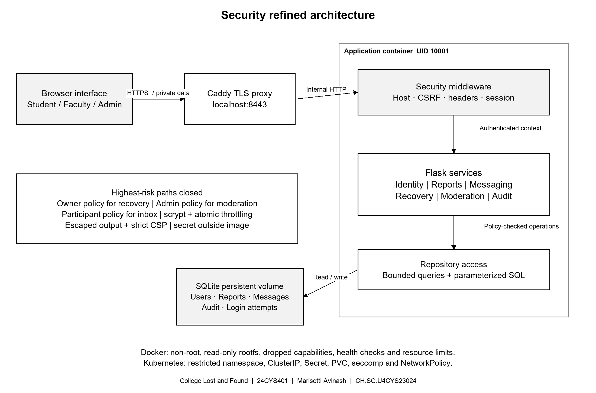

| Path | Preventive control | Detective control |
| --- | --- | --- |
| Compromise reporter identity | scrypt, TLS, signed secure cookie, atomic login rate bound | login_failed / login_throttled; planned alert on denial rate. |
| Choose victim ID and bypass authorization | can_manage policy; route state check; bound SQL; CSRF | recovery_denied with object ID; unauthorized-recovery test. |
| Escalate to moderation role | Admin decorator and operator-only provisioning | authorization_denied; moderation event metadata. |
| Read another conversation | Participant query and recipient-only reply | Cross-user inbox/reply regression test. |
| Write volume directly | Operator RBAC, ACL, container least privilege | Backup integrity and external audit export; app DB alone is not tamper-proof. |

# Phase 9 Product Backlog and Jira Scrum

| Epic | Scope | Jira key |
| --- | --- | --- |
| E1 | Identity and session security | CLF24-1 |
| E2 | Campus reporting and discovery | CLF24-2 |
| E3 | Private contact and recovery | CLF24-3 |
| E4 | Moderation and accountability | CLF24-4 |
| E5 | Secure build and quality assurance | CLF24-5 |
| E6 | Containers and secure deployment | CLF24-6 |

## US01 Account registration and sign in

As a campus user, I want to register and sign in so that I can access the service safely.

Requirement R01 | Epic E1 | Priority Must | Sprint 1 | Estimate 5 points | Task T01 | Jira CLF24-7

- Student and faculty register; administrator is provisioned by operator.
- Automated check test_registration_valid passes or deployment evidence confirms the control.
- No sensitive credentials are published in the implementation or evidence.

## US02 Report a lost item

As a student, I want to report a lost item so that I can ask the campus community for help.

Requirement R02 | Epic E2 | Priority Must | Sprint 1 | Estimate 5 points | Task T02 | Jira CLF24-9

- Capture title description category location and date; create pending report.
- Automated check test_pending_visibility passes or deployment evidence confirms the control.
- No sensitive credentials are published in the implementation or evidence.

## US03 Report a found item

As a finder, I want to report a found item so that I can return it to its owner.

Requirement R03 | Epic E2 | Priority Must | Sprint 1 | Estimate 3 points | Task T03 | Jira CLF24-11

- Use the same validated workflow with kind found.
- Automated check test_future_date_rejected passes or deployment evidence confirms the control.
- No sensitive credentials are published in the implementation or evidence.

## US04 Search verified reports

As a campus user, I want to search verified reports so that I can find a matching item.

Requirement R04 | Epic E2 | Priority Must | Sprint 1 | Estimate 5 points | Task T04 | Jira CLF24-13

- Search title description location and filter kind/category.
- Automated check test_sql_injection_search passes or deployment evidence confirms the control.
- No sensitive credentials are published in the implementation or evidence.

## US05 Private owner or finder contact

As a campus user, I want to contact an owner or finder privately so that I can reconnect without publishing my email.

Requirement R05 | Epic E3 | Priority Must | Sprint 1 | Estimate 5 points | Task T05 | Jira CLF24-15

- Authenticated contact through recipient-scoped internal inbox.
- Automated check test_private_messages_and_reply passes or deployment evidence confirms the control.
- No sensitive credentials are published in the implementation or evidence.

## US06 Owner-only recovery

As a reporter, I want to mark my report as recovered so that I can record a successful return.

Requirement R06 | Epic E3 | Priority Must | Sprint 1 | Estimate 5 points | Task T06 | Jira CLF24-17

- Only the reporting user can close an open verified report.
- Automated check test_unauthorized_recovery passes or deployment evidence confirms the control.
- No sensitive credentials are published in the implementation or evidence.

## US07 Administrator moderation

As a administrator, I want to verify or remove suspicious reports so that I can keep suspicious content off the board.

Requirement R07 | Epic E4 | Priority Must | Sprint 1 | Estimate 5 points | Task T07 | Jira CLF24-19

- Administrator verifies or soft-removes suspicious reports with reason.
- Automated check test_moderation_and_removal passes or deployment evidence confirms the control.
- No sensitive credentials are published in the implementation or evidence.

## US08 Personal report tracking

As a reporter, I want to track my own reports so that I can follow verification progress.

Requirement R08 | Epic E2 | Priority Should | Sprint 1 | Estimate 3 points | Task T08 | Jira CLF24-21

- Owner can see their pending verified and removed reports.
- Automated check test_pending_visibility passes or deployment evidence confirms the control.
- No sensitive credentials are published in the implementation or evidence.

## US09 Secure communication and sessions

As a campus user, I want to use secure sessions and communication so that I can protect my account and communication.

Requirement R09 | Epic E1 | Priority Must | Sprint 2 | Estimate 5 points | Task T09 | Jira CLF24-23

- TLS cookie security CSRF request limits CSP and password hashing.
- Automated check test_session_cookie_security passes or deployment evidence confirms the control.
- No sensitive credentials are published in the implementation or evidence.

## US10 Malicious content prevention

As a campus user, I want to view safely validated content so that I can view reports without executing malicious content.

Requirement R10 | Epic E5 | Priority Must | Sprint 2 | Estimate 5 points | Task T10 | Jira CLF24-25

- Escape displayed text and use parameterized SQL and bounded input.
- Automated check test_xss_escaped passes or deployment evidence confirms the control.
- No sensitive credentials are published in the implementation or evidence.

## US11 Security audit and monitoring

As a administrator, I want to inspect security audit metadata so that I can investigate misuse.

Requirement R11 | Epic E4 | Priority Must | Sprint 2 | Estimate 3 points | Task T11 | Jira CLF24-27

- Record login denial moderation recovery and message metadata without body or password.
- Automated check test_audit_contains_no_secrets passes or deployment evidence confirms the control.
- No sensitive credentials are published in the implementation or evidence.

## US12 Private reply and abuse control

As a message recipient, I want to reply privately with abuse controls so that I can reply safely without unsolicited access.

Requirement R12 | Epic E3 | Priority Should | Sprint 2 | Estimate 3 points | Task T12 | Jira CLF24-29

- Recipient-only replies; cap messages at ten per minute per sender.
- Automated check test_message_throttle passes or deployment evidence confirms the control.
- No sensitive credentials are published in the implementation or evidence.

## US13 Secure Docker packaging

As a operator, I want to package the application in Docker so that I can run a controlled container.

Requirement R13 | Epic E6 | Priority Must | Sprint 2 | Estimate 5 points | Task T13 | Jira CLF24-31

- Pinned dependencies non-root read-only rootfs least privilege TLS health check.
- Automated check test_health_and_headers passes or deployment evidence confirms the control.
- No sensitive credentials are published in the implementation or evidence.

## US14 Kubernetes deployment

As a operator, I want to deploy the application to Kubernetes so that I can deploy with restricted permissions.

Requirement R14 | Epic E6 | Priority Must | Sprint 2 | Estimate 5 points | Task T14 | Jira CLF24-33

- Restricted namespace limits secret PVC ClusterIP network policy.
- Automated check test_host_validation passes or deployment evidence confirms the control.
- No sensitive credentials are published in the implementation or evidence.

## US15 Verified delivery pipeline

As a developer, I want to run the verified delivery pipeline so that I can ship tested and checked changes.

Requirement R15 | Epic E5 | Priority Must | Sprint 2 | Estimate 5 points | Task T15 | Jira CLF24-35

- Checkout build tests static check dependency audit image package; fail on errors.
- Automated check test_end_to_end_report_verify_contact_recover passes or deployment evidence confirms the control.
- No sensitive credentials are published in the implementation or evidence.

## US16 Accessible consistent interface

As a campus user, I want to use an accessible consistent interface so that I can complete tasks with clear feedback.

Requirement R16 | Epic E2 | Priority Should | Sprint 2 | Estimate 3 points | Task T16 | Jira CLF24-37

- Responsive labelled controls error feedback cancel clear and progress views.
- Automated check test_body_limit passes or deployment evidence confirms the control.
- No sensitive credentials are published in the implementation or evidence.

| Sprint | Nominal fifteen-day schedule | Goal | Committed points |
| --- | --- | --- | --- |
| Sprint 1 Campus Core | 2026-10-08T09:00:00+05:30 to 2026-10-23T09:00:00+05:30 | Deliver identity reporting search moderation private contact and owner-only recovery. | 36 |
| Sprint 2 Secure Delivery | 2026-10-23T09:00:00+05:30 to 2026-11-07T09:00:00+05:30 | Harden the application verify abuse controls and deliver tested Docker Kubernetes and CI packages. | 34 |

Stories US01–US08 are planned for Sprint 1; US09–US16 for Sprint 2. Each story has one implementation/verification subtask. All Jira work items are assigned to Marisetti Avinash. No work is assigned to another person.

# Phase 10 Sprint Execution and Scrum Metrics

The workflow is To Do → In Progress → Testing → Done. Jira issue histories record actual transitions made during the lab. Completion is based on the retained implementation and verification evidence; the nominal sprint calendar is a plan, not proof that thirty days elapsed.

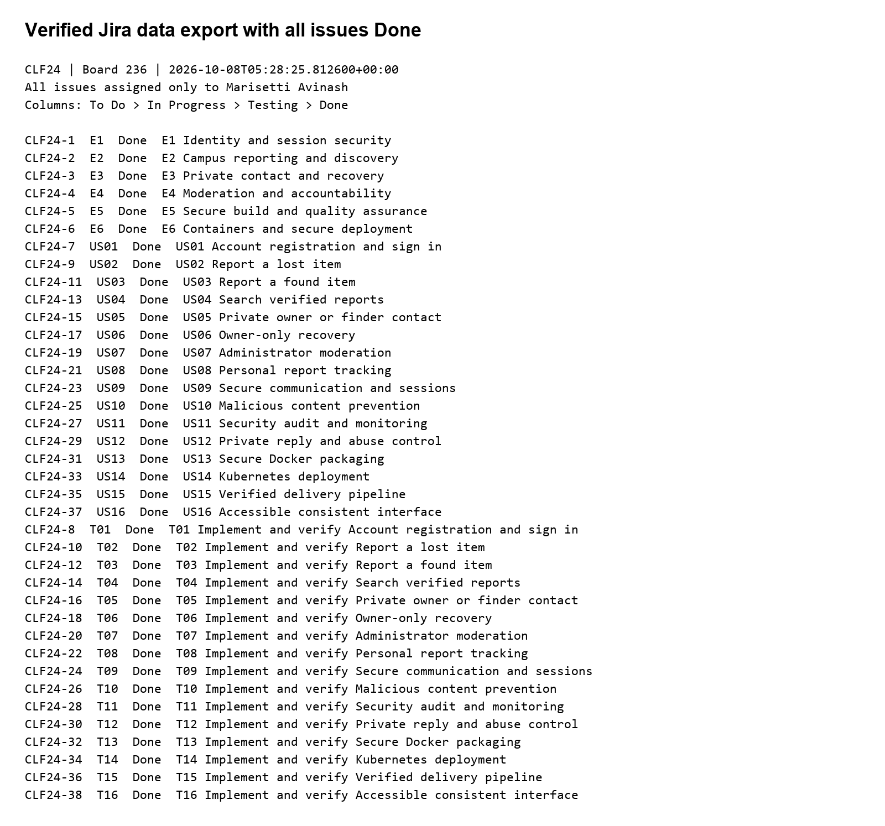

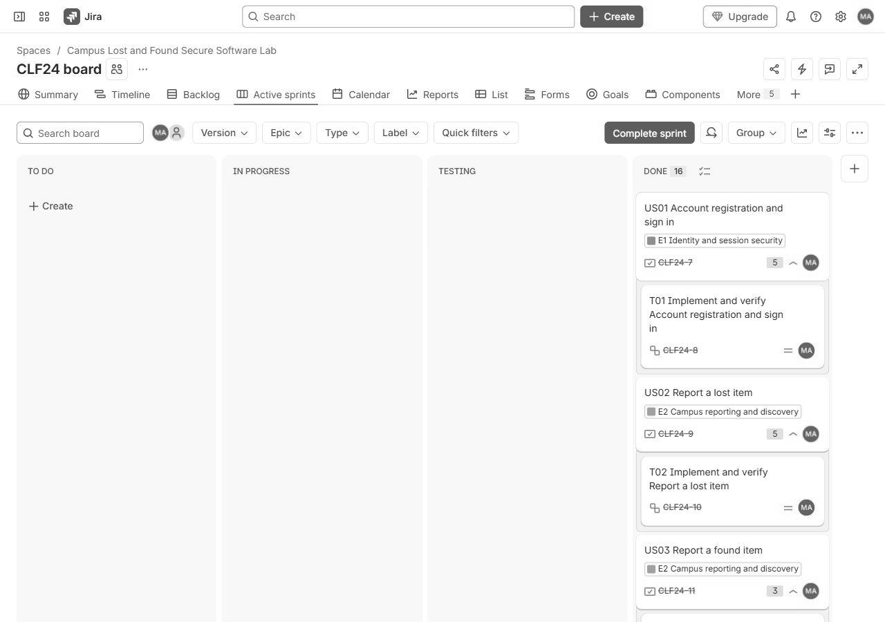

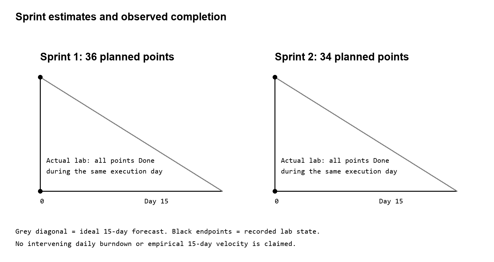

| Metric | Interpretation / value |
| --- | --- |
| Sprint 1 committed estimate | 36 story points |
| Sprint 2 committed estimate | 34 story points |
| Actual Done story points | 70 |
| Laboratory defects | Six verified fix groups: invalid-host handling, login throttling, moderation pagination, closed-message UI, vulnerable initial dependencies and the TLS image executable capability. |
| Carry-over | No unresolved implementation defects among the recorded fix groups after retests. Campus SSO, server-side revocation and immutable logging remain production improvement work. |
| Velocity interpretation | Completed estimate per sprint in this compressed lab; not an empirically observed fifteen-day team velocity. |

## Daily Scrum entry 8 October 2026

Progress: implemented identity, reporting, moderation, contact and recovery; ran automated and browser tests; patched vulnerable dependencies. Plan: verify container and cluster deployment, synchronize Jira completion and package the final report. Blockers encountered: sandbox Docker/network access, sprint-name length, Windows locked dependency file and Jira browser authentication. Technical blockers were handled through authorized engine access, shorter names and a fresh runtime; browser screenshots depend on normal user sign-in.

## Sprint review

The acceptance demonstration follows report submission → pending state → administrator verification → private contact and reply → reporter recovery. The screenshots and browser-e2e.json record that flow. Search and access-control tests cover the main abuse boundaries. Deployment observations are recorded in Phase 13 and its logs.

## Retrospective and improvement actions

- Run dependency audit before choosing initial pins, then keep hash-locked dependencies in the build.
- Include pagination, closed-state feedback and cross-user denial cases in the first acceptance review.
- Before campus release, connect campus SSO and central session revocation, export audits to a separate integrity-protected destination, and validate capacity under a real load profile.

# Phase 11 Secure Development and Build Environment

The local repository uses a main branch and a documented short-lived feature-branch/pull-request workflow. Secrets are supplied through environment or a Kubernetes Secret; generated local demonstration credentials and the .env file are ignored and excluded from the submission archive and Docker context.

| Control | Evidence or production requirement |
| --- | --- |
| Least privilege | Non-root application process; admin/report-owner/participant route policies; read-only CI token permissions. |
| Secret management | APP_SECRET and Jira credentials read from environment; no Jira token in source/report/archive; local secret files ignored. |
| Dependency control | Explicit patched versions; requirements.lock hashes; pip-audit result retained. |
| Review and branch policy | Feature branch → review → main is the intended workflow. Hosted branch protection requires configuring a remote and is not claimed as enforced locally. |
| Reproducible build and integrity | Pinned Python image digest/dependencies where recorded; build log, image digest and package SHA256 retained. |
| Automated checks | Bandit, project AST check, unit/integration/system/fuzz tests and dependency audit. |
| Private artifact scope | Local repository; no public publication of private credentials or campus records. |

Initial dependency scan recorded known advisories and was remediated with Flask 3.1.3, Werkzeug 3.1.9 and Click 8.3.3. The search query originally used only trusted SQL fragments and bound values; Bandit still flagged the dynamic construction. Refactoring to fixed SQL removed that warning without relying on a suppression. Final audit JSON and static-check JSON retain the actual results.

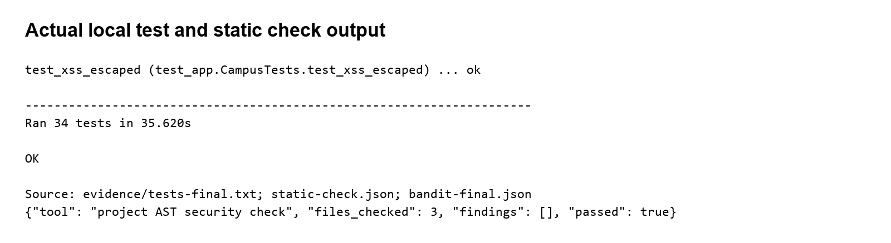

# Phase 12 Secure Coding and Refactoring

## Before structure stored as nonexecuted teaching text

```python
# Educational initial version. Never execute or deploy this example.
# Weakness 1: no owner authorization; user-supplied identifier controls the write.
def recover_item_before(conn, item_id):
    conn.execute(f"UPDATE reports SET status='recovered' WHERE id={item_id}")

# Weakness 2: trusting a form role allows privilege escalation; raw passwords stored.
def register_before(conn, form):
    conn.execute('INSERT INTO users(email,password_hash,role) VALUES(?,?,?)',
                 (form['email'],form['password'],form['role']))

```

## After authorization and validation

```python
def can_manage(user, report):
    return bool(user and user['id'] == report['reporter_id'])

# recover() validates CSRF in middleware, then:
if not can_manage(g.user, report):
    abort(403)
if report['moderation'] != 'verified' or report['status'] != 'open':
    abort(409)
# UPDATE binds report ID, user ID and timestamp as parameters.
```

```python
role = request.form.get('role')
if role not in ('student', 'faculty'):
    raise ValueError('Select student or faculty.')
password = validate_text(request.form.get('password'), 'Password', 12, 128)
password_hash = generate_password_hash(password, method='scrypt')
```

| Improvement | Security and maintainability outcome | Retest |
| --- | --- | --- |
| Central owner policy and bound update | Cannot use another report ID to change recovery; repeated rule is readable and testable. | test_unauthorized_recovery; test_recovery_idempotency |
| Role allowlist and password hash | Self-registration cannot create admin authority; password not stored as plaintext. | test_registration_admin_escalation_denied; test_password_not_plaintext |
| Fixed search SQL and validated input | SQL structure stays constant; malicious markup remains escaped; excessive fields fail safely. | test_sql_injection_search; test_xss_escaped; test_fuzz_report_boundary |
| Atomic attempt reservation and source scope | Concurrent requests cannot exceed the reservation window by racing the counter; another source is not denied solely by account-level attempts. | test_login_throttling; test_attacker_cannot_lock_out_other_source |
| Safe invalid-host error handling | Rejects malicious Host without a template routing error. | test_host_validation |

Connection-source limiting uses the direct remote address, stored as a keyed hash. Behind a shared reverse proxy, multiple clients can share that source. Production ingress must enforce its own client-IP rate limits; arbitrary forwarded headers are not trusted by this app. Sensitive text is escaped, errors are bounded and generic where appropriate, and audit metadata excludes password/message contents.

# Phase 13 Docker and Kubernetes Development

Docker packages the app behind Gunicorn with an unprivileged UID 10001. A writable data volume holds SQLite; the image filesystem is read-only at runtime. Capabilities are dropped, privilege escalation is disabled, health probes are defined and CPU/memory are bounded. Caddy supplies local HTTPS on port 8443 with an internal certificate authority.

| Runtime | Observed status | Evidence |
| --- | --- | --- |
| Docker build | Passed; pinned app and TLS images built | evidence/docker-build-final.txt |
| Docker process and health | Healthy; non-root read-only filesystem; all capabilities dropped | evidence/docker-runtime.json |
| TLS endpoint | Docker and Kubernetes TLSv1.3; certificate and hostname checks passed | evidence/docker-tls-smoke.json; kubernetes-tls-smoke.json |
| Kubernetes rollout | Isolated kind deployment 2/2 ready; app and TLS sidecar | evidence/kubernetes.txt |
| Kubernetes controls | Restricted namespace; non-root; seccomp; PVCs; ClusterIP; limits verified. NetworkPolicy enforcement not established on default kind CNI. | deploy/kubernetes.yaml; evidence/kubernetes-security.json |

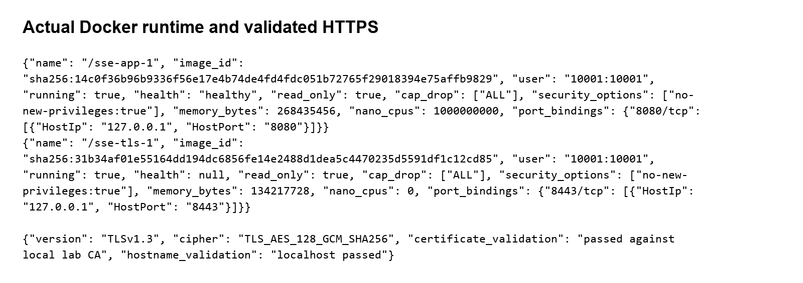

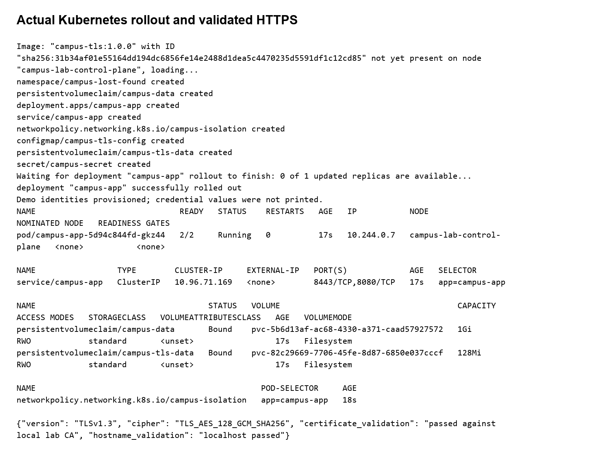

| Container security practice | Implementation |
| --- | --- |
| Minimal versioned image | Python slim runtime, explicit dependency pins; image digest captured. |
| Non-root execution | USER 10001:10001; writable volume owned by that identity. |
| Restricted filesystem and privileges | read_only root; /tmp tmpfs; cap_drop ALL; no-new-privileges. |
| Controlled exposure | Host loopback bindings; TLS 8443; internal app traffic on 8080. |
| Secrets outside image | Environment APP_SECRET; Docker context excludes local credential files. |
| Resource and health controls | App 256 MiB/1 CPU; Gunicorn bounded workers; DB health endpoint. |

| Kubernetes control | Configuration and prerequisite |
| --- | --- |
| Namespace isolation | campus-lost-found with restricted Pod Security Admission labels. |
| Process least privilege | runAsNonRoot, UID/GID 10001, RuntimeDefault seccomp, no escalation, dropped capabilities. |
| Storage and availability | 1Gi PVC, one replica, Recreate strategy; SQLite requires exclusive single-node use. |
| Restricted exposure | ClusterIP with unprivileged TLS sidecar on 8443. Loopback port-forward HTTPS was validated against the exported lab CA. Production requires a campus certificate and controlled ingress. |
| Network policy | Ingress limited to ingress-nginx namespace; egress denied. Enforcement depends on the CNI; kind default networking does not establish enforcement. |
| Secret management | campus-secret is created from generated local configuration without storing its value in the manifest. |
| Resource limits | 100m/96Mi requested; 1 CPU/256Mi limits; readiness and liveness probes. |

# Phase 14 CI and Security Testing

The GitHub Actions workflow defines checkout, pinned dependency installation, unit/integration/system/fuzz tests, static checks, dependency audit, Docker build and image packaging. A local equivalent pipeline runs the same checks and preserves logs. A hosted GitHub Actions run is not claimed without a remote run record.

| Test category | Concrete checks | Result evidence |
| --- | --- | --- |
| Unit module tests | validate_text boundaries and can_manage ownership policy. | tests-final.txt |
| Integration tests | Database-backed pending visibility, moderation, messaging and recovery state checks. | tests-final.txt |
| System validation | Report → verify → private message → reply → recovery, both automated and browser UI. | test_end_to_end_report_verify_contact_recover; browser-e2e.json |
| Simple fuzzing | Nine title-boundary inputs including empty/oversize/control/SQL/markup/Unicode/wildcards. No unhandled 500; accepted markup escapes on display. | test_fuzz_report_boundary |
| Static analysis | Bandit and project AST rules for dangerous execution debug and literal credentials. | bandit-final.json; static-check.json |
| Dependency audit | Pinned application dependency inventory checked against advisory service. | dependency-audit-before.json; dependency-audit.json |
| Container integration | Health TLS and authenticated workflow against running container where logged. | docker-e2e.json; kubernetes-e2e.json |

| Defect | Severity | Observed issue | Fix | Retest |
| --- | --- | --- | --- | --- |
| DEF01 | Medium | Invalid Host caused error-template routing failure | Return safe plain error if no url_rule exists | test_host_validation passes |
| DEF02 | Medium | Account-wide / nonatomic login attempt bound | Immediate transaction; keyed source/account scope | Throttle and different-source tests pass |
| DEF03 | Medium | Old pending reports unreachable after 100 new reports | Pending-first paginated moderation queue | test_admin_pagination passes |
| DEF04 | Low | Reply input visible for closed reports | Hide closed report reply input; retain server denial | test_closed_inbox_hides_reply passes |
| DEF05 | High | Known vulnerable initial dependency pins | Upgrade to patched versions; audit again | No known vulnerabilities in final audit |
| DEF06 | Medium | Caddy executable file capability prevented startup after all capabilities were dropped | Remove executable file capability; serve unprivileged 8443 as UID 10001 | Docker and Kubernetes TLS workflows pass |

The first 31-test run exposed DEF01; final 34-test retests pass. Raw logs distinguish environment setup failures from application defects. These results verify the laboratory implementation; no production exploitation is claimed.

# Phase 15 Logging Monitoring Hardening and Deployment

| Event | Logged fields | Handling |
| --- | --- | --- |
| login_failed / login_throttled | Event outcome timestamp; no password | Investigate elevated denial rate; do not expose identifiers on public dashboard. |
| authorization_denied / recovery_denied | Actor object event outcome UTC time | Alert on repeated unauthorized actions. |
| report_verified / report_removed | Actor report ID decision outcome time | Reason/moderator stored on report; audit provides accountability. |
| item_recovered | Actor report ID success time | Trace integrity-sensitive state change. |
| message_sent / message_reply | Actor report ID event outcome time | No message body in audit; participant privacy preserved. |
| registration / login_success / logout | Event actor when authenticated outcome timestamp | Support identity lifecycle review without credential values. |

| Metric or alert | Threshold or signal | Operator response |
| --- | --- | --- |
| Login-denial rate | More than 20 denials in five minutes per source/account group | Review brute-force/lockout pattern and ingress rate controls. |
| Authorization denial | More than five 403 policy denials in five minutes | Review actor/object access attempts. |
| Moderation queue age | Pending report older than 24 hours | Administrator checks backlog and removes unsafe content. |
| Service health and error rate | Health probe failures or 5xx rate over 1% | Inspect process/storage/resource conditions and rollback verified image. |
| Resource saturation | Memory above 80% or disk free below 15% | Check retention and add capacity; do not delete required evidence blindly. |
| Message throttling | Repeated rate-limit responses | Investigate harassment and restrict abusive accounts through a future admin policy. |
| Backup freshness | No verified backup in 24 hours | Run encrypted backup and perform restore verification. |

Monitoring metrics are a defined operating plan. The implemented lab exposes health and administrator audit views; a full metrics collector and alert-routing service are future production integrations. Audit records share the SQLite authority with the app and are not independently immutable.

- Access: restrict host/cluster administration, use MFA on Jira and deployment accounts, provision admin separately and review privileges.
- Ports/services: expose only the intended TLS endpoint; keep app and database local/internal; disable development debug.
- Secrets: random APP_SECRET, private local-file ACL, Kubernetes Secret/RBAC; rotate credentials through an operator process.
- Updates: audit dependencies and base image before each release; retain reviewed digests and rollback image.
- Permissions: non-root container, read-only rootfs, cap drop, restricted namespace and bounded writable volume.
- Physical controls: lock workstation and campus server area; restrict removable media and backup access.
- Operational controls: documented recovery, retention policy, encrypted backups, restore exercises and incident owner.
- Deployment checklist: validate configuration; run tests and audits; verify health and TLS; provision admin; test access denial; capture rollout and integrity evidence.

# Phase 16 Final Security Review

| Trace step | Linked evidence |
| --- | --- |
| Requirement | R06 Reporter-only recovery |
| Use case | UC05 Mark item recovered |
| DFD | P3 Contact/recovery → D2 Reports; audit to D4 |
| Threat | TH03 Tamper with another user’s recovery state |
| Vulnerability | V01 Nonexecuted initial teaching function lacks owner check |
| Attack tree | Authorization bypass branch: choose victim ID AND defeat owner policy |
| User story | US06 Owner-only recovery; Epic E3 |
| Sprint task | Sprint 1 T06; Jira CLF24-18 |
| Implementation | app.py can_manage() and recover(); bound update and open/verified precondition |
| Test | test_unauthorized_recovery; test_recovery_idempotency; browser recovery result |
| Deployment control | TLS edge, externally supplied session secret, non-root read-only container, private DB volume |

| Highest-risk issue | Enforced controls and remaining boundary |
| --- | --- |
| Unauthorized state modification | Reporter/admin policies, CSRF, bound SQL and state checks; denial regression tests. |
| Private conversation or credential disclosure | Participant-scoped queries, email omission, password hashing, TLS and secure cookies; privileged storage operators remain trusted. |
| Compromised build/runtime | Patched pinned dependencies, clean audit/static checks, isolated image and cluster controls; public production release requires verified certificate/SSO and operational configuration. |

## Remaining limitations and future improvements

First, self-registration does not verify campus membership; integrate campus SSO, account lifecycle management and centralized revocable sessions before production use. Second, SQLite and local operator-controlled audit storage fit this single-node lab but do not provide multi-node availability or immutable forensic logging; move to a managed relational store with encrypted backups and a separate audit destination when campus scale requires it.

## Final observations

The case-study identifiers align from requirements through tests and deployment controls. Technical results are supported by source, raw logs, API records and application screenshots. Nominal sprint schedules and forecast charts are distinguished from compressed laboratory execution; modelled risk is distinguished from observed defects. The final evidence index records exactly which runtime checks completed.

## Authoritative technical references

Flask security guidance
https://flask.palletsprojects.com/en/stable/web-security/

Werkzeug changes
https://werkzeug.palletsprojects.com/en/stable/changes/

Jira REST projects
https://developer.atlassian.com/cloud/jira/platform/rest/v3/api-group-projects/

Jira workflows
https://developer.atlassian.com/cloud/jira/platform/rest/v3/api-group-workflows/

Jira sprint API
https://developer.atlassian.com/cloud/jira/software/rest/api-group-sprint/

kind quick start
https://kind.sigs.k8s.io/docs/user/quick-start/

Kubernetes security checklist
https://kubernetes.io/docs/concepts/security/security-checklist/
